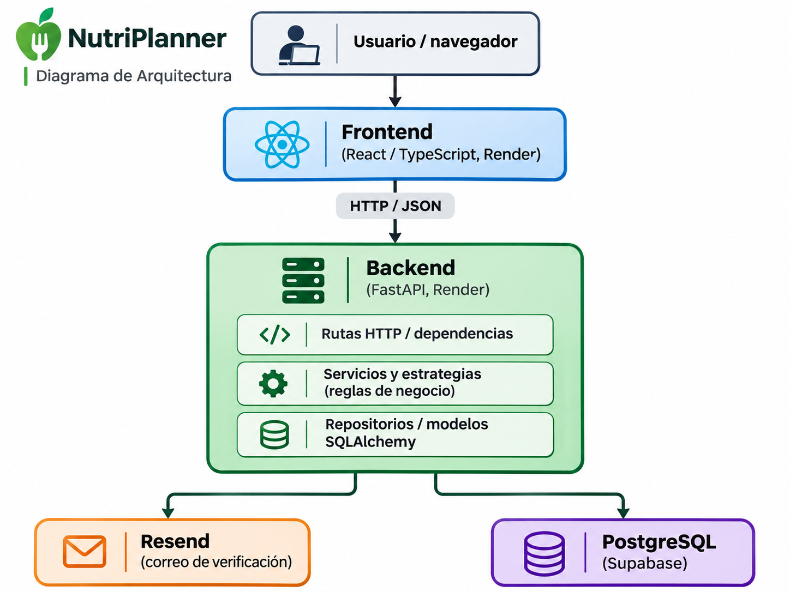

# NutriPlanner API

API REST del proyecto **NutriPlanner**, desarrollada para **Programación II — UNSAM**.

NutriPlanner permite consultar recetas precargadas y preparar menús personalizados a partir del perfil alimentario del usuario: alergias, ingredientes y categorías de alimentos que evita, y nivel culinario. La aplicación no realiza diagnósticos ni recomendaciones clínicas; tampoco calcula automáticamente el valor nutricional de las recetas.

> **Estado del proyecto (noviembre de 2026): DEMO académica funcional.** Esta versión implementa el circuito central de registro, perfil, consulta de recetas, generación, sustitución y guardado de menús. **No representa todavía la totalidad del MVP proyectado.** El alcance detallado y las funcionalidades pendientes se encuentran en [docs/requirements.md](docs/requirements.md) (versión 3.0).

## Accesos

- **Aplicación web:** https://nutriplanner-front.onrender.com
- **API desplegada:** https://nutriplanner-api.onrender.com
- **Documentación interactiva (Swagger):** https://nutriplanner-api.onrender.com/docs
- **Estado básico del servicio:** https://nutriplanner-api.onrender.com/health
- **Repositorio del frontend:** https://github.com/sxlvtti/nutriplanner-front

`GET /health` comprueba que el proceso de FastAPI responde; no equivale a una prueba integral de la base de datos ni de todas las operaciones.

## Funcionalidades implementadas en la demo

- Registro e inicio de sesión de usuarios con contraseñas protegidas mediante **Argon2** y autenticación mediante **JWT**.
- Verificación de correo mediante **Resend**: envío de enlaces, confirmación con token temporal y reenvío. La exigencia de verificación se controla con una variable de entorno y puede estar desactivada.
- Creación, consulta y actualización del perfil alimentario.
- Consulta de catálogos precargados de alergias, ingredientes y categorías de alimentos.
- Consulta de recetas y evaluación de compatibilidad con las restricciones del usuario.
- Evaluación de restricciones mediante el patrón de diseño **Strategy** (alergias, ingredientes y categorías).
- Generación de propuestas temporales de menús de **1 a 7 días**, para desayuno, almuerzo, merienda y cena.
- Selección de sustituciones de ingredientes previamente definidas y validación antes del guardado.
- Guardado de menús completos, consulta del historial y eliminación de menús propios. Los menús guardados conservan instantáneas de las recetas, las sustituciones confirmadas y la fecha de inicio (`fecha_inicio`). Este último campo es opcional para mantener la compatibilidad con menús creados anteriormente.
- Gestión de recetas favoritas y excluidas.

**Alcances y limitaciones:** la generación no guarda automáticamente el menú; el usuario debe confirmar sus comidas y sustituciones. Los cambios o reemplazos realizados en el frontend se revalidan al guardar. En la demo, el frontend utiliza un comensal y tamaño de porción normal, aunque la API contempla otros valores dentro de sus restricciones. El catálogo y los datos nutricionales son precargados.

### Funcionalidades previstas, no implementadas íntegramente

- Reutilización editable de un menú histórico con revalidación.
- Calificaciones de recetas y promedio de valoraciones.
- Reportes de recetas y administración/moderación.
- Funcionalidades opcionales, como exportación de menús a PDF, recuperación de contraseña y eliminación de cuenta.

El estado y las prioridades de estas funciones se detallan en la especificación de requisitos; **no deben presentarse como entregadas**.

## Tecnologías

| Tecnología | Uso |
| --- | --- |
| Python 3.12 (imagen Docker) | Lenguaje y entorno de ejecución |
| FastAPI + Uvicorn | API REST y servidor ASGI |
| SQLAlchemy | ORM y acceso a datos |
| Alembic | Migraciones del esquema |
| PostgreSQL (Supabase) | Persistencia en el entorno desplegado |
| SQLite | Base de datos para desarrollo y pruebas locales |
| Pydantic / pydantic-settings | Validación y configuración |
| PyJWT | Autenticación con tokens |
| pwdlib + Argon2 | Hash de contraseñas |
| Resend (API HTTP) | Envío de correos de verificación |
| pytest | Pruebas automatizadas |
| Docker + Render | Contenerización y despliegue de la API |

## Arquitectura



*Figura 1. Arquitectura general de NutriPlanner y conexiones entre sus componentes.*

El frontend consume la API FastAPI. La API se conecta a PostgreSQL en Supabase mediante SQLAlchemy y el controlador `psycopg`; **no utiliza PostgREST como sustituto del backend**.

### Organización del código

| Ruta | Responsabilidad |
| --- | --- |
| `app/api/routes/` | Endpoints HTTP |
| `app/api/dependencies.py` | Dependencias de autenticación |
| `app/core/` | Configuración, seguridad y enumeraciones |
| `app/db/` | Motor y sesiones de base de datos |
| `app/models/` | Modelos persistentes de SQLAlchemy |
| `app/schemas/` | Esquemas de entrada y salida |
| `app/repositories/` | Consultas y operaciones de persistencia |
| `app/services/` | Casos de uso y lógica de negocio |
| `app/strategies/` | Estrategias de evaluación de restricciones |
| `alembic/` | Versiones y ejecución de migraciones |
| `tests/` | Pruebas automatizadas |
| `docs/` | Requisitos y diagramas |

## Instalación y ejecución local

Se recomienda **Python 3.12** y Git. La ejecución local puede usar SQLite, sin necesidad de una instancia PostgreSQL de producción.

### 1. Clonar y crear un entorno virtual

```bash
git clone https://github.com/KarenGonzalesCh/nutriplanner-api.git
cd nutriplanner-api
python -m venv .venv
```

Activar el entorno:

- **Windows / PowerShell:** `.\.venv\Scripts\Activate.ps1`
- **Linux / macOS:** `source .venv/bin/activate`

### 2. Instalar dependencias

```bash
python -m pip install -r requirements.txt
```

### 3. Configurar variables de entorno

Copiar `.env.example` a `.env`:

- **PowerShell:** `Copy-Item .env.example .env`
- **Linux / macOS:** `cp .env.example .env`

Un ejemplo **solo para desarrollo local**:

```dotenv
DATABASE_URL=sqlite:///./nutriplanner.db
SECRET_KEY=reemplazar-por-una-clave-larga-y-aleatoria
ALGORITHM=HS256
ACCESS_TOKEN_EXPIRE_MINUTES=30
EMAIL_VERIFICATION_ENABLED=false
FRONTEND_URL=http://localhost:8080
```

No reutilizar la clave de ejemplo para producción. Con la verificación desactivada no se necesitan las credenciales de Resend para registrar usuarios locales.

### 4. Inicializar la base de datos y aplicar migraciones

La inicialización de una base de datos nueva requiere cargar los catálogos y las recetas iniciales antes de ejecutar determinadas migraciones de datos.

Para una base PostgreSQL nueva y vacía, se validó el siguiente procedimiento:

```bash
# 1. Crear la estructura inicial
python -m alembic upgrade 1a77b668d21f

# 2. Cargar categorías, alergias e ingredientes
python -m app.db.seed_catalogos

# 3. Cargar las recetas iniciales
python -m app.db.seed_recetas

# 4. Aplicar las migraciones restantes
python -m alembic upgrade head
```

### 5. Iniciar la API

```bash
python -m uvicorn app.main:app --reload
```

- API: http://localhost:8000
- Swagger: http://localhost:8000/docs
- ReDoc: http://localhost:8000/redoc

Para usar el frontend local, configurar su `VITE_API_URL=http://localhost:8000` y utilizar un origen autorizado por el CORS del backend (actualmente puertos locales 8080 a 8083). Revisar el puerto del frontend si Vite inicia en otro.

## Variables de entorno

| Variable | Uso | Requerida |
| --- | --- | --- |
| `DATABASE_URL` | Cadena de conexión SQLAlchemy | Sí |
| `SECRET_KEY` | Firma de tokens JWT | Sí |
| `ALGORITHM` | Algoritmo JWT (por defecto `HS256`) | No |
| `ACCESS_TOKEN_EXPIRE_MINUTES` | Duración del JWT (por defecto 30) | No |
| `EMAIL_VERIFICATION_ENABLED` | Exige verificación de correo (`true` / `false`) | No; por defecto `false` |
| `RESEND_API_KEY` | Credencial privada del proveedor de correos | Si se activa la verificación |
| `EMAIL_FROM` | Remitente permitido por Resend | Si se activa la verificación |
| `FRONTEND_URL` | Base para los enlaces de confirmación | Necesaria para enlaces correctos |
| `EMAIL_VERIFICATION_TOKEN_HOURS` | Vigencia del enlace (por defecto 24 horas) | No |
| `EMAIL_VERIFICATION_RESEND_SECONDS` | Intervalo mínimo de reenvío (por defecto 60 segundos) | No |

**Seguridad:** `.env`, `DATABASE_URL`, `SECRET_KEY` y `RESEND_API_KEY` no deben publicarse en GitHub ni en capturas. En Render se configuran como variables del servicio.

## Endpoints principales

| Método | Ruta | Función |
| --- | --- | --- |
| `GET` | `/health` | Estado básico del servicio |
| `POST` | `/cuentas` | Registro de cuenta |
| `GET` | `/cuentas/me` | Consulta de la cuenta autenticada |
| `POST` | `/auth/token` | Inicio de sesión; devuelve JWT |
| `POST` | `/auth/verificar-correo` | Confirmación mediante token |
| `POST` | `/auth/reenviar-verificacion` | Reenvío de enlace |
| `POST` | `/perfil` | Creación de perfil alimentario |
| `GET` | `/perfil/me` | Consulta de perfil propio |
| `PUT` | `/perfil/me` | Actualización de perfil |
| `GET` | `/alergias` | Catálogo de alergias |
| `GET` | `/ingredientes` | Catálogo de ingredientes |
| `GET` | `/categorias-alimento` | Catálogo de categorías |
| `GET` | `/recetas` | Consulta / filtrado de recetas |
| `GET` | `/recetas/{receta_id}` | Detalle de receta |
| `GET` | `/recetas/{receta_id}/compatibilidad` | Compatibilidad con el perfil |
| `GET`, `PUT`, `DELETE` | `/recetas/{receta_id}/sustituciones[/{receta_ingrediente_id}]` | Consulta, guardado o eliminación de sustituciones (según método y ruta) |
| `GET` | `/recetas/favoritas` y `/recetas/excluidas` | Preferencias del usuario |
| `POST`, `DELETE` | `/recetas/{receta_id}/favorita` y `/recetas/{receta_id}/exclusion` | Marcar o quitar preferencias |
| `POST` | `/menus/generar` | Generar propuesta temporal |
| `POST` | `/menus` | Guardar menú completo validado |
| `GET` | `/menus` | Historial de menús propios |
| `GET`, `DELETE` | `/menus/{menu_id}` | Consultar o eliminar menú propio |

Las rutas protegidas requieren `Authorization: Bearer <token>`. El endpoint `POST /auth/token` recibe las credenciales como formulario `application/x-www-form-urlencoded`, con el correo en el campo `username`. Consultar `/docs` para los esquemas, parámetros y códigos de respuesta completos.

## Verificación de correo electrónico

La verificación es **configurable**. Con `EMAIL_VERIFICATION_ENABLED=true`:

1. El usuario se registra y la cuenta queda pendiente de verificación.
2. El backend crea un token temporal y conserva únicamente su hash.
3. Resend envía un enlace basado en `FRONTEND_URL`.
4. El frontend recibe el token y llama a `POST /auth/verificar-correo`.
5. Tras la confirmación, el usuario puede iniciar sesión. Los enlaces vencidos o ya utilizados no pueden reutilizarse.

El backend también permite solicitar un nuevo enlace mediante `POST /auth/reenviar-verificacion`. Las cuentas existentes al aplicar la migración fueron marcadas como verificadas para evitar bloquearlas.

**Estado de validación:** el 7/11/2026 se comprobó manualmente en el despliegue el registro, la generación del correo, la confirmación y el inicio de sesión posterior. Sigue pendiente una prueba manual explícita del rechazo de login antes de verificar. La cuenta de Resend utiliza actualmente el remitente de prueba `onboarding@resend.dev`, que tiene restricciones de destinatarios; para un uso abierto debe configurarse un dominio remitente verificado. Esto no sustituye una auditoría de seguridad ni pruebas integrales de entrega de correo.

## Pruebas automatizadas

```bash
python -m pytest -v
```

Las pruebas cubren, entre otros módulos, cuentas y autenticación, verificación de correo, modelos, catálogos, perfiles, restricciones, compatibilidad, generación, validación y guardado de menús, alternativas y sustituciones.


**Última validación (08/11/2026):** se ejecutó la suite completa del backend mediante `python -m pytest -q`, obteniendo **204 pruebas aprobadas y 4 advertencias**, sin fallos.

Entre las pruebas se incluye la verificación del guardado, consulta y eliminación de menús con y sin el campo `fecha_inicio`, asegurando la compatibilidad con solicitudes anteriores.

Además, GitHub Actions ejecutó correctamente las pruebas automatizadas después de integrar el PR #24 en `main`.

La cantidad de pruebas puede modificarse en futuras versiones, por lo que se recomienda ejecutar nuevamente la suite para validar cada entrega.

## Despliegue

El backend está desplegado como **Web Service Docker en Render**, desde la rama `main` de este repositorio, y se conecta a una base **PostgreSQL alojada en Supabase**. El frontend se despliega por separado en Render.

La imagen utiliza el `Dockerfile` del repositorio. Su comando de inicio ejecuta:

```bash
python -m alembic upgrade head && uvicorn app.main:app --host 0.0.0.0 --port 8000
```

Esto aplica las migraciones pendientes antes de iniciar la API. Para PostgreSQL, `DATABASE_URL` debe usar un esquema SQLAlchemy compatible con el driver instalado, por ejemplo `postgresql+psycopg://...`; la cadena real se guarda **solo** como variable de entorno en Render. Antes de migraciones que afecten datos en producción, generar o verificar un respaldo y revisar los cambios.

La API permite solicitudes CORS desde `https://nutriplanner-front.onrender.com` y desde los orígenes locales explícitamente configurados en `app/main.py`. La variable `FRONTEND_URL` sirve para crear los enlaces de verificación; no modifica por sí sola la lista CORS.

**Consideración sobre la inicialización:** el despliegue actual utiliza una base PostgreSQL previamente inicializada en Supabase. El comando `alembic upgrade head` aplica las migraciones pendientes, pero una instalación completamente nueva requiere cargar previamente los datos iniciales descritos en la sección de instalación.

La migración `bc1da46fd604`, que incorpora `fecha_inicio` a los menús, fue validada en PostgreSQL con datos existentes. Se comprobó que conserva los menús anteriores, sus comidas y sus instantáneas, dejando `fecha_inicio` en `NULL` cuando no se había registrado una fecha.


### Comprobaciones posteriores al despliegue

- Confirmar que Render indique `Live` y que los logs no muestren errores al ejecutar Alembic o iniciar Uvicorn.
- Abrir `/health` y `/docs`.
- Probar el acceso desde el frontend a los endpoints necesarios.
- Si se activa la verificación de correo, comprobar registro, entrega del mensaje, confirmación y autenticación, con destinatarios permitidos por Resend.

## Documentación relacionada

- [Especificación de requisitos, demo y MVP proyectado (v3.0)](docs/requirements.md)
- [Diagramas y documentación del proyecto](docs/)
- [Frontend NutriPlanner](https://github.com/sxlvtti/nutriplanner-front)

---

**Proyecto académico de Programación II — UNSAM.**
